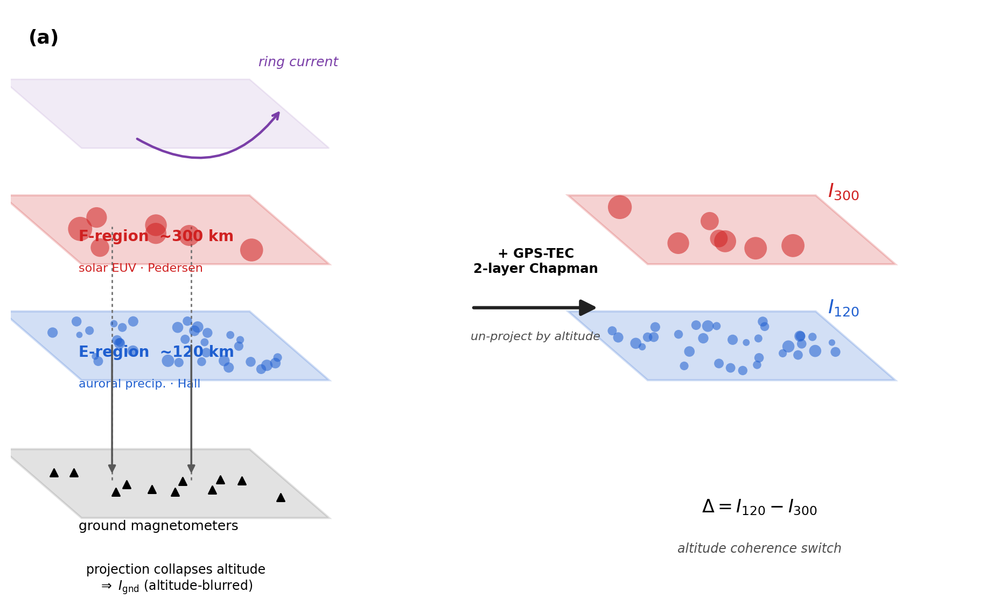

# Magnetospheric Tomography: Altitude-Resolved Spatial Coherence of Ionospheric Currents

Reproducibility package for the preprint **"Altitude-Resolved Spatial Coherence of
Ionospheric Current Systems from Combined Ground Magnetometry and GPS Total Electron
Content"** (B. Stephenson, 2026).

The method decomposes the spatial coherence of geomagnetic perturbations **by altitude**.
Ground magnetometers record only the summed vertical *projection* of current systems at
different heights, so a ground-level spatial-autocorrelation statistic (Moran's *I*) is
altitude-blurred. Pairing SuperMAG with CODE GPS-TEC maps through a two-layer Chapman model
"un-projects" the coherence into an E-region (~120 km) measure `I_120`, an F-region
(~300 km) measure `I_300`, and their difference `Δ = I_120 − I_300` — a candidate
altitude-coherence diagnostic. See **Figure 1** in the paper for the concept.



## Repository layout

```
paper/    the manuscript (LaTeX source + compiled PDF) and its figures
code/     the analysis pipeline, figure generators, and robustness tests
data/     derived data products (aggregated Moran's I values) — see data/README.md
```

## What is and isn't included (data policy)

- **Included:** the *derived* products in `data/derived/paper1_data/` — the per-epoch
  aggregated Moran's *I* values (`I_gnd`, `I_120`, `I_300`, `Δ`, ...) for every event in
  the paper. These regenerate the figures and summary statistics directly.
- **Not included — must be fetched:** the *raw* SuperMAG station data. SuperMAG's data
  policy requires each user to register and does not permit re-hosting. CODE GPS-TEC,
  Swarm, and Van Allen Probes inputs are openly licensed but are likewise not bundled here
  for size. **See [`data/README.md`](data/README.md) for how to obtain each source** and
  where the loaders expect it.

## Reproduce

```bash
python -m venv .venv && . .venv/bin/activate
pip install -r code/requirements.txt

cd code
python make_fig1_concept.py     # Figure 1a — concept schematic (no data needed)
python make_fig1b_clean.py      # Figure 1b — real two-layer result from data/derived/
```

`make_fig1b_clean.py` reads only the shipped derived products, so it runs out of the box.
`test_coordinate.py`, `test_persector.py`, `test_robustness.py`, and
`export_altitude_data.py` reconstruct results from **raw** inputs and therefore require the
SuperMAG/CODE data fetched per `data/README.md`. Run all scripts from `code/`.

## Cite

If you use this method, data products, or code, please cite the paper (and, once minted,
this repository's Zenodo DOI). See [`CITATION.cff`](CITATION.cff).

## License

- **Code** (`code/`): MIT — see [`LICENSE`](LICENSE).
- **Paper, figures, and derived data** (`paper/`, `data/`): Creative Commons Attribution
  4.0 International (CC-BY-4.0).

## Data attribution

This work uses **SuperMAG** (Gjerloev, 2012), **CODE** Global Ionosphere Maps
(Schaer, 1999), **Swarm** (ESA), and **Van Allen Probes** (NASA). Please honor each
provider's data-use and acknowledgment requirements; details in `data/README.md`.
